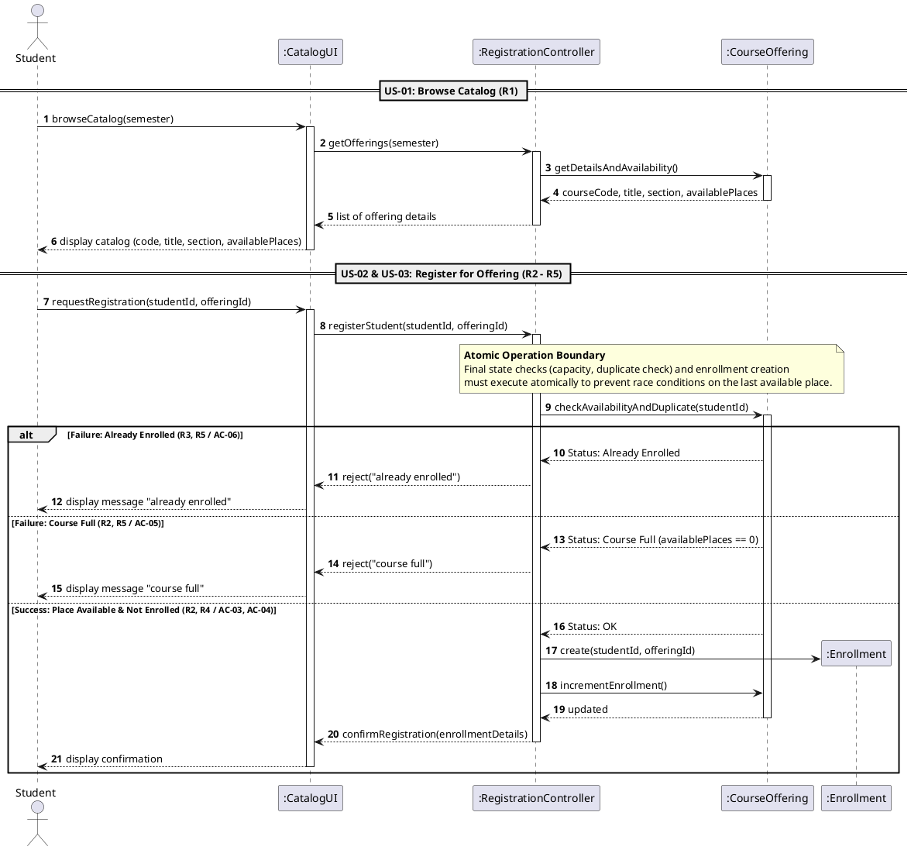

# SIS #02 — AI-Assisted UML Modeling: University Course Registration

<!--
  This is the only file you write your report in. README.md tells you what goes where.

  Rules the checker relies on:
  - Do not delete, rename or renumber the ## headings, the ### headings, or the **Label:** words.
  - Replace every "(write here)" and "(paste here)". None may be left when you submit.
  - Comments like this one are ignored by the checker and the word counter. Delete them or leave them.
-->

## 1. Scope and assumptions

**Scope:** The system lets a signed-in student browse the course offerings of one semester with their available places, request registration for one chosen offering, and receive either a confirmation or a clear rejection ("course full" or "already enrolled"). Out of scope are payments, prerequisites, timetable clashes, waiting lists and cancellation.

**Assumptions:**

1. The student is signed in, the selected offering exists, and its capacity is a positive whole number.
2. The final duplicate check, the capacity check and the creation of the Enrollment form one atomic operation, so two competing requests cannot take the same last place.
3. A catalog view does not reserve a place, so it can be out of date; availability is checked again when the student registers.

## 2. User stories and acceptance criteria

### US-01 — Browse offerings

**US-01:** As a student, I want to browse the course catalog for a semester, so that I can see the available offerings and their remaining places before I choose one.

- **AC-01** (R1): Given a signed-in student opens the catalog for one semester, When the list of offerings is shown, Then each offering displays the course code, title, offering and available places.
- **AC-02** (R1): Given an offering has 0 available places, When a student views the catalog, Then the offering is shown with 0 available places and no place is reserved for the student.

### US-02 — Register for an offering

**US-02:** As a student, I want to register for a specific course offering, so that I get a place in that section.

- **AC-03** (R2, R3, R4): Given an offering has available places and the student has no enrollment in it, When the student requests registration, Then the system creates exactly one Enrollment linking the student and the offering, decreases the available places by 1 and returns a confirmation.
- **AC-04** (R2, R3, R4): Given an offering has exactly 1 available place and the student has no enrollment in it, When the student requests registration, Then the system creates exactly one Enrollment, the available places become 0 and a confirmation is returned.

### US-03 — Receive a clear rejection

**US-03:** As a student, I want to get a clear message when my registration cannot be completed, so that I understand why it was declined.

- **AC-05** (R2, R5): Given the catalog showed a place in an offering but its current enrollment count now equals its capacity, When the student requests registration, Then the system rejects the request with "course full", creates no Enrollment and leaves the enrollment count unchanged.
- **AC-06** (R3, R5): Given a student already has an enrollment in an offering, When the same student requests registration for that offering again, Then the system rejects the request with "already enrolled", creates no new Enrollment and leaves the enrollment count unchanged.
## 3. Sequence diagram

<!-- The FINAL diagram, rendered. Change .png to .svg if that is what you exported. -->


**Participants:** (write here — each lifeline and what it stands for)

**Atomic operation:** (write here — which messages form the one atomic step: the final duplicate check, the capacity check and the creation of the Enrollment, and why a catalog view reserves nothing)

**Where the Enrollment is created:** (write here — which message, which lifeline, and which class in section 4 it produces)

**Technical lifelines:** (write here — every lifeline that is NOT a class in the class diagram, by name, and why the difference in abstraction is fine. "None" if there are none.)

## 4. Class diagram

<!-- The FINAL diagram, rendered. -->


<!-- One row per association in classes.puml, read in both directions. -->

| Association | Read left to right | Read right to left |
| --- | --- | --- |
| (write here) | (write here) | (write here) |
| (write here) | (write here) | (write here) |
| (write here) | (write here) | (write here) |

**How an Enrollment links a student to an offering:** (write here)

**Capacity constraint:** (write here — and why multiplicity alone cannot express it)

**Uniqueness constraint:** (write here — and why multiplicity alone cannot express it)

## 5. Traceability

<!-- Every rule, including the catalog fields and availability (R1). Column 1: the rule and
     the criteria that cover it, e.g. "R2 + AC-03, AC-04". Column 2: the message, guard,
     class or constraint that shows the rule in YOUR diagrams. Column 3: the T-ID that
     exercises it, or the extra check you did instead (R1 has no T case). -->

| Rule and criterion | Model evidence | Validation case |
| --- | --- | --- |
| R1 + (write here) | (write here) | (write here) |
| R2 + (write here) | (write here) | (write here) |
| R3 + (write here) | (write here) | (write here) |
| R4 + (write here) | (write here) | (write here) |
| R5 + (write here) | (write here) | (write here) |

## 6. Walkthroughs

<!-- Walk each case through YOUR final sequence diagram, message by message. Column 2: the
     actual steps and the state change (count before → after). Column 3 starts with Pass or
     Fail, then the location: the message, guard or note where you saw it. A Fail you
     report honestly is a finding, not a penalty. -->

| Case | Observed path and state change | Judgment and evidence |
| --- | --- | --- |
| T1. Available | (write here) | (write here) |
| T2. Last place | (write here) | (write here) |
| T3. Full | (write here) | (write here) |
| T4. Duplicate | (write here) | (write here) |

## 7. Review decisions

<!-- At least three substantive decisions about Prompt C's critique or your own inspection.
     Decision: accepted / rejected / modified — and what you did. Reason: why, in a full
     sentence. Rule: R1–R5. Do not invent an error to fill the table; a justified rejection
     of advice counts. -->

| AI suggestion or model element | Decision | Reason | Rule |
| --- | --- | --- | --- |
| (write here) | (write here) | (write here) | (write here) |
| (write here) | (write here) | (write here) | (write here) |
| (write here) | (write here) | (write here) | (write here) |

## 8. Modeling explanation

<!-- 200–300 words. Your main design choices; how the class diagram and the sequence diagram
     complement each other; why an activity diagram could also help explain the workflow. -->

(write here)

## 9. Reflection

<!-- 150–200 words. Written by you, not by the assistant: where AI helped, one decision you
     made yourself, one remaining limitation. Specific beats flattering. -->

(write here)

## 10. Appendix A — Before AI

**Scope:** The system allows authenticated students to browse available course offerings for a single semester and register for selected sections with enforced capacity and duplicate enrollment checks while excluding payment, prerequisite, schedule conflict, waitlist, and cancellation workflows.

**Initial assumptions:**

1. Students are pre-authenticated and all course offerings presented in the catalog exist with positive integer capacities.
2. The final availability verification and enrollment record creation execute as a single atomic database operation.

## 11. Appendix B — AI exchanges

<!-- Complete prompts and complete responses, as text — never screenshots. Paste each inside
     the ~~~~ block that follows its label: AI responses contain ``` PlantUML blocks, and
     ~~~~ keeps them from breaking this file. Prompts B and C: the prompt text first, then
     the material it refers to ("below", "these two") pasted under it, in the same block.
     You may add B5, B6 … after B4 if you ran more. -->

### B1 — Requirements (Prompt A)

- **Tool:** Gemini
- **Model:** Gemini 2.5 Flash
- **Date:** 2026-10-18
- **Purpose:** draft 3 user stories and 6 acceptance criteria

<!-- Model: the exact model with its version, as the tool shows it (e.g. "GPT-5 Thinking",
     "Claude Sonnet 4.5"). If the tool does not show it, write: not displayed
     Date: YYYY-MM-DD -->

**Prompt:**

~~~~text
Act as a requirements analyst. Use only this course registration scenario and rules R1-R5: A student browses an electronic course catalog, chooses a course offering and requests registration. Each offering has a limited number of places. A Course describes a subject. A CourseOffering is one scheduled section in one semester. Registration always targets a specific offering. Assume that the student is signed in, the selected offering exists, and its capacity is a positive whole number. R1 Catalog: Show the course code, title, offering and available places for one semester. R2 Capacity: Recheck current availability when registering. Enrollment must never exceed the offering's capacity. R3 Duplicates: A student may have at most one enrollment in the same offering. Reject a repeat request. R4 Success: Create exactly one Enrollment linking the student and offering, update availability and return a confirmation. R5 Rejection: Explain "course full" or "already enrolled". Create no enrollment and leave the enrollment count unchanged. My initial assumptions are 1. Students are pre-authenticated and all course offerings presented in the catalog exist with positive integer capacities. 2. The final availability verification and enrollment record creation execute as a single atomic database operation.
Draft 3 user stories and 2 Given / When / Then acceptance criteria for each. Use IDs US-01 to US-03 and AC-01 to AC-06. Map each criterion to rule IDs.
Cover normal and rejection behavior. List uncertainty separately. Do not add excluded features or invent university policies.
~~~~

**Response:**

~~~~text
##### User Stories

###### US-01 — Browse Course Catalog

**User Story:** As an authenticated student, I want to browse the course catalog for a semester so that I can view available sections and remaining places to select a section for registration.

---

###### US-02 — Register for Course Offering

**User Story:** As an authenticated student, I want to register for a specific course offering so that I can secure my place in the class section.

---

###### US-03 — Receive Clear Rejection Message

**User Story:** As an authenticated student, I want to receive a clear rejection message when registration fails so that I understand why my request was declined.

---

##### Acceptance Criteria

###### US-01 — Browse Course Catalog

* **AC-01 (Mapped to Rule R1): Catalog Information Display**
* **Given** an authenticated student opens the course catalog for a semester,


* **When** the list of offerings is retrieved,


* **Then** the system displays the course code, course title, section/offering identifier, and available places for each course offering.


* **AC-02 (Mapped to Rule R1): Zero Availability Display**
* **Given** a course offering has 0 remaining places,


* **When** the student views the catalog,


* **Then** the section is displayed showing 0 available places without reserving any seat.


---

###### US-02 — Register for Course Offering

* **AC-03 (Mapped to Rules R2, R4): Successful Registration**
* **Given** a course offering with available places (> 0) and no existing enrollment for the student,


* **When** the student submits a registration request for that offering,


* **Then** the system creates exactly one Enrollment record linking the student to the offering, decreases available places by 1, and returns a confirmation.


* **AC-04 (Mapped to Rules R2, R4): Last Seat Registration Boundary**
* **Given** a course offering with exactly 1 remaining place and no existing enrollment for the student,


* **When** the student submits a registration request for that offering,


* **Then** the system creates exactly one Enrollment record, updates available places to 0, and returns a confirmation.


---

###### US-03 — Receive Clear Rejection Message

* **AC-05 (Mapped to Rules R2, R5): Full Capacity Rejection**
* **Given** a course offering that has 0 available places,


* **When** the student attempts to register for this offering,


* **Then** the system rejects the request with the message "course full", creates no Enrollment record, and leaves the enrollment count unchanged.


* **AC-06 (Mapped to Rules R3, R5): Duplicate Registration Rejection**
* **Given** a student who already holds an active enrollment in the selected course offering,


* **When** the student submits a repeat registration request for the same offering,


* **Then** the system rejects the request with the message "already enrolled", creates no duplicate Enrollment record, and leaves the enrollment count unchanged.


---

##### Uncertainty & Unspecified Items

1. **Concurrent Request Handling & Priority:** While initial assumptions state that availability verification and enrollment creation execute as a single atomic database operation, the exact queueing or tie-breaking mechanism for two requests targeting the last remaining seat at the exact same millisecond is unspecified in rules R1–R5.


2. **Catalog Refresh / Live Updates:** Rules R1–R5 do not specify whether the catalog view automatically updates seat counts in real time via websockets/polling or requires a manual page refresh by the student to view modified availability.
~~~~

### B2 — UML drafts (Prompt B)

- **Tool:** Gemini
- **Model:** Gemini 2.5 Flash
- **Date:** 2026-10-18
- **Purpose:** draft the sequence and class diagrams

**Prompt:**

~~~~text
Using my approved scenario, Scenario: A student browses an electronic course catalog, chooses a course offering and requests registration. Each offering has a limited number of places. A Course describes a subject. A CourseOffering is one scheduled section in one semester. Registration always targets a specific offering. Assume that the student is signed in, the selected offering exists, and its capacity is a positive whole number. R1–R5, stories and criteria below, return separate PlantUML code blocks for a sequence diagram and a domain class diagram.
Sequence: include catalog browsing and guarded success, full-course and duplicate outcomes. Model final checks and creation as one atomic operation.
Class: show domain concepts, useful attributes and multiplicities. State the capacity and uniqueness constraints. Explain assumptions and any technical lifelines.
| **R1. Catalog** | Show the course code, title, offering and available places for one semester. |
| **R2. Capacity** | Recheck current availability when registering. Enrollment must never exceed the offering's capacity. |
| **R3. Duplicates** | A student may have at most one enrollment in the same offering. Reject a repeat request. |
| **R4. Success** | Create exactly one Enrollment linking the student and offering, update availability and return a confirmation. |
| **R5. Rejection** | Explain "course full" or "already enrolled". Create no enrollment and leave the enrollment count unchanged. |

These rules define this assignment. **A catalog view does not reserve a place.** Model the final
checks and enrollment creation as one atomic operation so competing requests cannot take the same
last place. A note describing the atomic operation is sufficient; database implementation is
outside this assignment.
User stories and acceptance criteria

### US-01 — Browse offerings

**US-01:** As a student, I want to browse the course catalog for a semester, so that I can see the available offerings and their remaining places before I choose one.

- **AC-01** (R1): Given a signed-in student opens the catalog for one semester, When the list of offerings is shown, Then each offering displays the course code, title, offering and available places.
- **AC-02** (R1): Given an offering has 0 available places, When a student views the catalog, Then the offering is shown with 0 available places and no place is reserved for the student.

### US-02 — Register for an offering

**US-02:** As a student, I want to register for a specific course offering, so that I get a place in that section.

- **AC-03** (R2, R3, R4): Given an offering has available places and the student has no enrollment in it, When the student requests registration, Then the system creates exactly one Enrollment linking the student and the offering, decreases the available places by 1 and returns a confirmation.
- **AC-04** (R2, R3, R4): Given an offering has exactly 1 available place and the student has no enrollment in it, When the student requests registration, Then the system creates exactly one Enrollment, the available places become 0 and a confirmation is returned.

### US-03 — Receive a clear rejection

**US-03:** As a student, I want to get a clear message when my registration cannot be completed, so that I understand why it was declined.

- **AC-05** (R2, R5): Given the catalog showed a place in an offering but its current enrollment count now equals its capacity, When the student requests registration, Then the system rejects the request with "course full", creates no Enrollment and leaves the enrollment count unchanged.
- **AC-06** (R3, R5): Given a student already has an enrollment in an offering, When the same student requests registration for that offering again, Then the system rejects the request with "already enrolled", creates no new Enrollment and leaves the enrollment count unchanged.
~~~~

**Response:**

~~~~text
### Technical Lifelines & Modeling Assumptions

1. **System & Controller Lifelines**:
* `Student`: Represents the signed-in actor initiating UI interactions.
* `CatalogUI`: Web/UI interface presenting views and status messages.
* `RegistrationController`: System boundary controller orchestrating application logic and atomicity.
* `CourseOffering`, `Enrollment`: Domain entities maintaining state and business rules.


2. **Atomic Registration Transaction**:
* The sequence diagram models the final checks (R2: capacity check, R3: duplicate check) and creation of `Enrollment` inside an `alt` success path as a single atomic operation (e.g., within a database transaction boundary).


3. **Derived Availability**:
* Available places are calculated as `capacity - count(Enrollments)`. Displaying availability in the catalog view (R1) allocates no lock/reservation.


---

### Sequence Diagram



---

### Domain Class Diagram


---

### Key Constraints & Rules Summary

* **Capacity Constraint (R2)**: $0 \le \text{Enrollment Count} \le \text{Capacity}$. `CourseOffering.capacity` is a strictly positive whole number ($\text{capacity} > 0$). Available places are dynamically determined by subtracting current enrollment count from capacity.
* **Uniqueness Constraint (R3)**: Duplicate enrollments are prohibited by enforcing a unique tuple constraint on `(studentId, offeringId)`.
* **Atomicity Guarantee (R4, R5)**: Catalog visualization does not hold or lock places. Re-checking constraints and instantiating `Enrollment` occur inside an atomic boundary to eliminate race conditions.
~~~~

### B3 — Model critique (Prompt C)

- **Tool:** Gemini
- **Model:** Gemini 2.5 Flash
- **Date:** 2026-10-18
- **Purpose:** review both models against R1–R5 and T1–T4

**Prompt:**

~~~~text
(paste here)
~~~~

**Response:**

~~~~text
(paste here)
~~~~

### B4 — Focused revision (Prompt D)

- **Tool:** (write here)
- **Model:** (write here)
- **Date:** (write here)
- **Purpose:** apply my accepted review decisions

**Prompt:**

~~~~text
(paste here)
~~~~

**Response:**

~~~~text
(paste here)
~~~~

## 12. Appendix C — Original diagrams

<!-- The AI's first output from Prompt B, rendered unedited from models/original/. -->


## 13. Appendix D — References and source checks

### References

<!-- Full references, one per line, each starting with "- ". Only sources you actually opened.
     Every URL used in the source checks must also appear here. Example:
     - Sommerville, I. (2016). Software Engineering, 10th ed., Global Edition. Pearson. Ch. 5. -->

- (write here)

### Source checks

<!-- At least two modeling decisions you verified. Source and locator: title + slide, page,
     section, chapter or figure — or title + URL + access date (YYYY-MM-DD). Slide numbers
     refer to the decks posted in our Teams. -->

| Modeling decision | Source and locator | What the source says | How it supports or changed your model |
| --- | --- | --- | --- |
| (write here) | (write here) | (write here) | (write here) |
| (write here) | (write here) | (write here) | (write here) |
