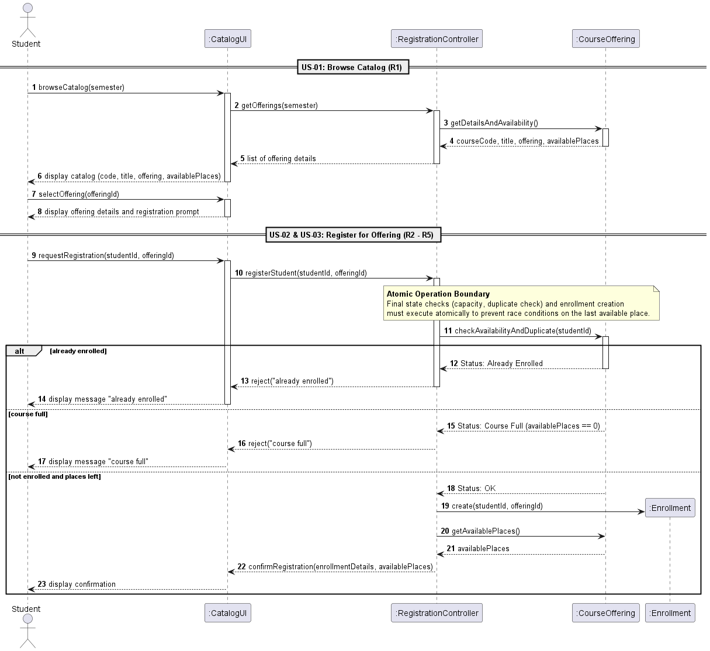
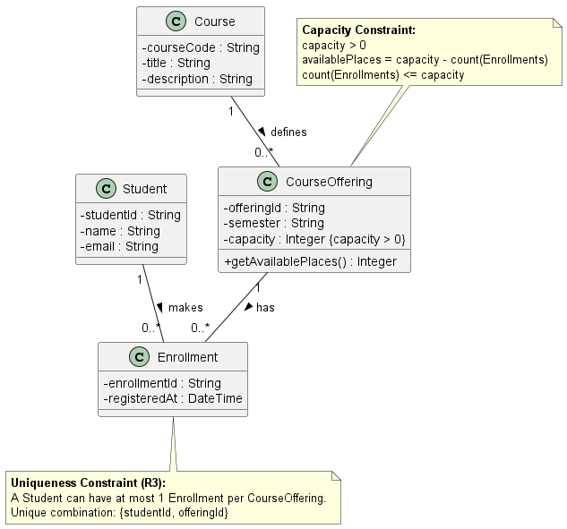
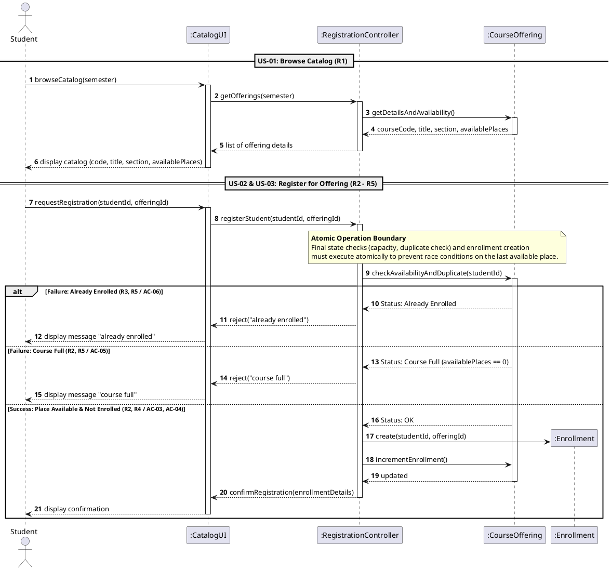
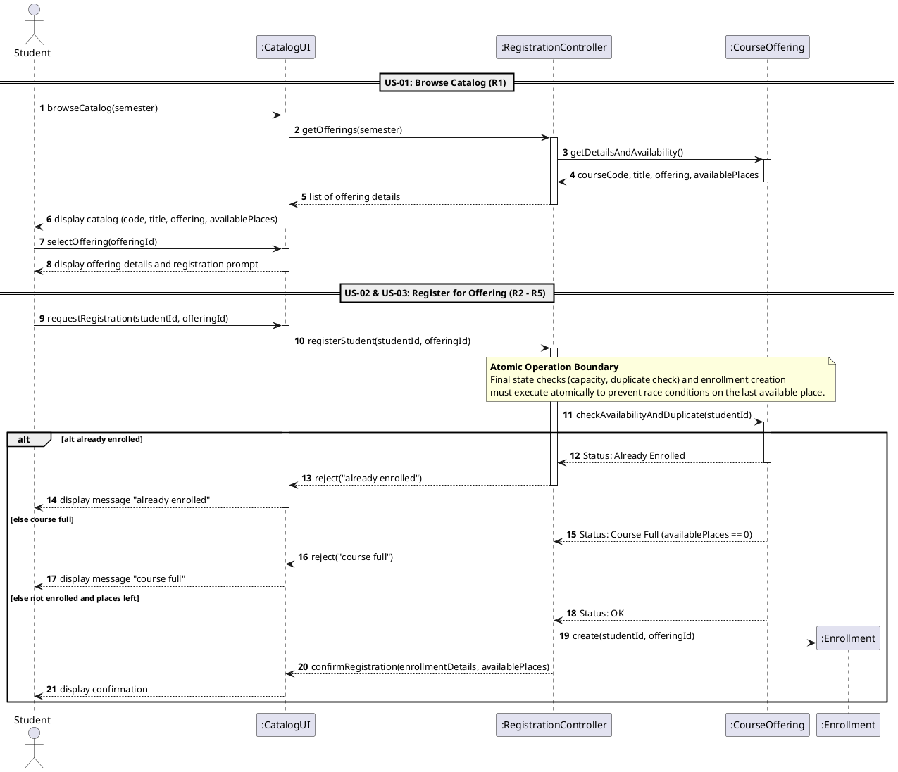
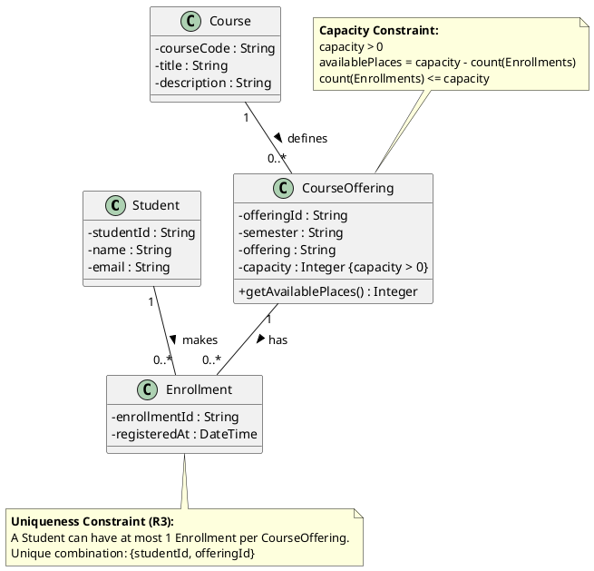
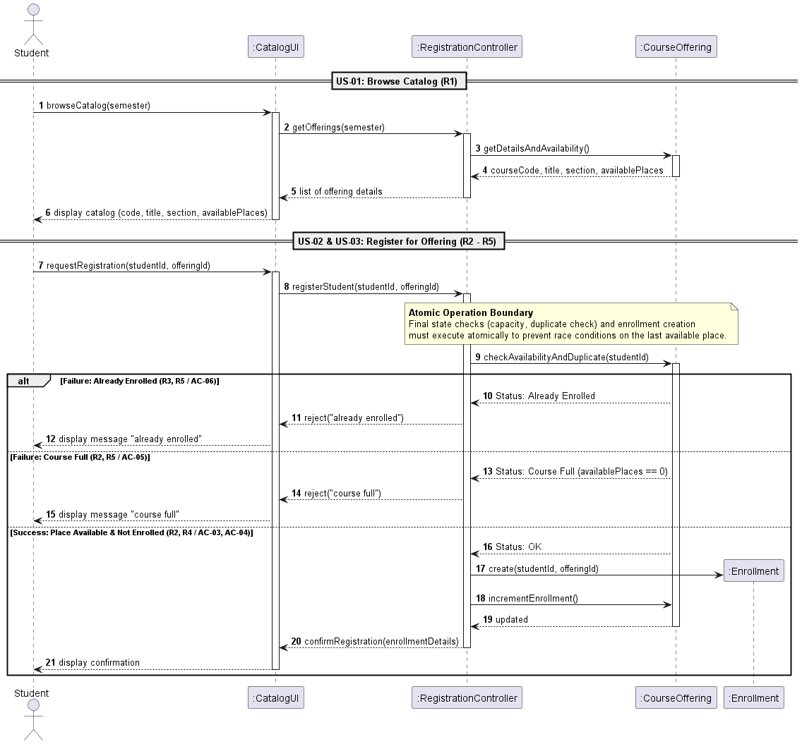

# SIS #02 — AI-Assisted UML Modeling: University Course Registration

<!--
  This is the only file you write your report in. README.md tells you what goes where.

  Rules the checker relies on:
  - Do not delete, rename or renumber the ## headings, the ### headings, or the **Label:** words.
  - Replace every "(write here)" and "(paste here)". None may be left when you submit.
  - Comments like this one are ignored by the checker and the word counter. Delete them or leave them.
-->

## 1. Scope and assumptions

**Scope:** The system lets a signed-in student browse the course offerings of one semester with their available places, request registration for one chosen offering, and receive either a confirmation or a clear rejection ("course full" or "already enrolled"). Out of scope are payments, prerequisites, timetable clashes, waiting lists and cancellation.

**Assumptions:**

1. The student is signed in, the selected offering exists, and its capacity is a positive whole number.
2. The final duplicate check, the capacity check and the creation of the Enrollment form one atomic operation, so two competing requests cannot take the same last place.
3. A catalog view does not reserve a place, so it can be out of date; availability is checked again when the student registers.

## 2. User stories and acceptance criteria

### US-01 — Browse offerings

**US-01:** As a student, I want to browse the course catalog for a semester, so that I can see the available offerings and their remaining places before I choose one.

- **AC-01** (R1): Given a signed-in student opens the catalog for one semester, When the list of offerings is shown, Then each offering displays the course code, title, offering and available places.
- **AC-02** (R1): Given an offering has 0 available places, When a student views the catalog, Then the offering is shown with 0 available places and no place is reserved for the student.

### US-02 — Register for an offering

**US-02:** As a student, I want to register for a specific course offering, so that I get a place in that section.

- **AC-03** (R2, R3, R4): Given an offering has available places and the student has no enrollment in it, When the student requests registration, Then the system creates exactly one Enrollment linking the student and the offering, decreases the available places by 1 and returns a confirmation.
- **AC-04** (R2, R3, R4): Given an offering has exactly 1 available place and the student has no enrollment in it, When the student requests registration, Then the system creates exactly one Enrollment, the available places become 0 and a confirmation is returned.

### US-03 — Receive a clear rejection

**US-03:** As a student, I want to get a clear message when my registration cannot be completed, so that I understand why it was declined.

- **AC-05** (R2, R5): Given the catalog showed a place in an offering but its current enrollment count now equals its capacity, When the student requests registration, Then the system rejects the request with "course full", creates no Enrollment and leaves the enrollment count unchanged.
- **AC-06** (R3, R5): Given a student already has an enrollment in an offering, When the same student requests registration for that offering again, Then the system rejects the request with "already enrolled", creates no new Enrollment and leaves the enrollment count unchanged.

## 3. Sequence diagram

<!-- The FINAL diagram, rendered. Change .png to .svg if that is what you exported. -->



**Participants:** Student is the signed-in person using the system. CatalogUI is the screen that shows the catalog and the messages. RegistrationController receives the requests and runs the steps in order. CourseOffering is the section the student wants a place in. Enrollment is the record that is created when the registration succeeds.

**Atomic operation:** The messages from checkAvailabilityAndDuplicate to create(studentId, offeringId) are one atomic step, marked by the note over RegistrationController and CourseOffering. The duplicate check, the capacity check and the creation of the Enrollment cannot be split, so two students cannot both take the last place. The catalog view reserves nothing because browseCatalog and selectOffering only read data and happen before the note, so a place can be gone by the time the student registers (T3).

**Where the Enrollment is created:** In the message create(studentId, offeringId) sent by :RegistrationController to :Enrollment, in the branch else not enrolled and places left. It produces an instance of the class Enrollment from section 4. It comes before confirmRegistration, so the student is never told "registered" before the Enrollment exists.

**Technical lifelines:** CatalogUI and RegistrationController are not classes in the class diagram. They are the screen and the controller that run the process, while the class diagram shows only the business concepts (Student, Course, CourseOffering, Enrollment). The difference in abstraction is fine because each diagram answers a different question: who does what and in what order, and what the system stores.

## 4. Class diagram

<!-- The FINAL diagram, rendered. -->



<!-- One row per association in classes.puml, read in both directions. -->

| Association | Read left to right | Read right to left |
| --- | --- | --- |
| Course "1" -- "0..*" CourseOffering : defines | One Course defines zero or more CourseOfferings. | Each CourseOffering belongs to exactly one Course. |
| Student "1" -- "0..*" Enrollment : makes | One Student makes zero or more Enrollments. | Each Enrollment is made by exactly one Student. |
| CourseOffering "1" -- "0..*" Enrollment : has | One CourseOffering has zero or more Enrollments. | Each Enrollment belongs to exactly one CourseOffering. |

**How an Enrollment links a student to an offering:** Enrollment sits between Student and CourseOffering. It has exactly one Student and exactly one CourseOffering, through the two associations above, so one Enrollment is one student registered in one offering.

**Capacity constraint:** The note on CourseOffering says count(Enrollments) <= capacity. Multiplicity cannot express it because 0..* only says an offering may have any number of Enrollments. It cannot compare that number with the capacity attribute of the same offering.

**Uniqueness constraint:** The note on Enrollment says one Student has at most one Enrollment per CourseOffering. Multiplicity cannot express it because each end is counted on its own: a student may have many Enrollments and an offering may have many, but the multiplicities say nothing about the pair student plus offering being unique.

## 5. Traceability

<!-- Every rule, including the catalog fields and availability (R1). Column 1: the rule and
     the criteria that cover it, e.g. "R2 + AC-03, AC-04". Column 2: the message, guard,
     class or constraint that shows the rule in YOUR diagrams. Column 3: the T-ID that
     exercises it, or the extra check you did instead (R1 has no T case). -->

| Rule and criterion | Model evidence | Validation case |
| --- | --- | --- |
| R1 + AC-01, AC-02 | Messages 3–6: getDetailsAndAvailability returns courseCode, title, offering, availablePlaces, and the catalog displays them; no reservation message exists. Classes: Course (courseCode, title), CourseOffering (semester, getAvailablePlaces()) | No T case; extra check: compared the fields in messages 4 and 6 with the four items named in R1 |
| R2 + AC-03, AC-04, AC-05 | Message 11 checkAvailabilityAndDuplicate inside the atomic note; branch else course full (messages 15–17); capacity note on CourseOffering | T2, T3 |
| R3 + AC-03, AC-04, AC-06 | Message 11 and branch alt already enrolled (messages 12–14); uniqueness note on Enrollment | T4 |
| R4 + AC-03, AC-04 | Branch else not enrolled and places left: message 19 create, 20–21 getAvailablePlaces, 22 confirmRegistration after creation; Enrollment linked to Student and CourseOffering | T1, T2 |
| R5 + AC-05, AC-06 | Branches already enrolled and course full: reject("already enrolled") at 13, reject("course full") at 16, no create message in either branch | T3, T4 |

## 6. Walkthroughs

<!-- Walk each case through YOUR final sequence diagram, message by message. Column 2: the
     actual steps and the state change (count before → after). Column 3 starts with Pass or
     Fail, then the location: the message, guard or note where you saw it. A Fail you
     report honestly is a finding, not a penalty. -->

| Case | Observed path and state change | Judgment and evidence |
| --- | --- | --- |
| T1. Available | Messages 1–6 show the catalog, 7–8 the student selects the offering, 9–10 the registration request reaches the controller. Message 11 checks the offering and 18 returns Status: OK. Message 19 creates the Enrollment, 20–21 read the places left, 22–23 confirm. Enrollments: 0 → 1 (capacity 2, 1 place left). | Pass — branch else not enrolled and places left (messages 18–23). The Enrollment is created at 19 before the confirmation at 22. |
| T2. Last place | Same path as T1: 9–11, Status: OK at 18, create at 19, getAvailablePlaces at 20–21, confirmation at 22–23. Enrollments: 1 → 2 (capacity 2), and message 21 returns 0 places left, which goes into the confirmation. | Pass — branch else not enrolled and places left (messages 18–23). Message 19 creates the second Enrollment and 21 shows no places remain. |
| T3. Full | Messages 1–6 show a place in the catalog. Between 6 and 9 the count becomes 2 of 2 (the diagram shows no second student, only the gap). 9–11: the check runs again inside the atomic note. The student is new, so already enrolled (12–14) is skipped. Message 15 returns Course Full, 16–17 reject. Enrollments: 2 → 2. | Pass — branch else course full (messages 15–17). No create message (19) in this branch, so no new Enrollment. |
| T4. Duplicate | The same student requests again: 9–10, then message 11 checks. Message 12 returns Status: Already Enrolled, 13 rejects with already enrolled, 14 shows it to the student. Enrollments: 1 → 1. | Pass — branch alt already enrolled (messages 12–14). No create at 19 and no confirmation at 22, so nothing is saved. |

## 7. Review decisions

<!-- At least three substantive decisions about Prompt C's critique or your own inspection.
     Decision: accepted / rejected / modified — and what you did. Reason: why, in a full
     sentence. Rule: R1–R5. Do not invent an error to fill the table; a justified rejection
     of advice counts. -->

| AI suggestion or model element | Decision | Reason | Rule |
| --- | --- | --- | --- |
| Original: deactivate offering only in the success branch (Prompt C, issue 1) | Modified: closed offering, controller and ui in every branch | Prompt C named only offering, but controller and ui bars also stayed open after both rejections | R5 |
| Original: incrementEnrollment() after create (Prompt C, issue 2) | Accepted: removed the call, availability stays capacity minus the number of Enrollments | The count was stored and also calculated, so the two could disagree in T2 | R4, R2 |
| Original: create(studentId, offeringId); Prompt C proposes offering.createEnrollment(student) | Rejected: the controller keeps creating the Enrollment | The diagram already shows who is linked, and moving creation adds a message without fixing any rule | R4 |
| Prompt C optional point: CourseOffering as information expert with register(student) | Rejected: the controller keeps orchestrating | A visible atomic block with the checks is required, and one hidden call would hide the guards used in T3 and T4 | R2, R3 |
| Original alt labels with rule IDs, and Prompt D output alt alt already enrolled / else else course full | Modified: set to alt already enrolled, else course full, else not enrolled and places left | The handout requires these exact guards, and Prompt D repeated the keywords, which is wrong PlantUML | R3, R2, R4 |
| Original: no step where the student selects an offering, and section used instead of offering | Modified: added selectOffering (7–8), section renamed offering in the messages | R1 and AC-01 say offering, and browse, select and register must be three separate steps | R1 |
| Prompt D output: @endl at the end of both files | Modified: replaced with @enduml | The files would not render, and Prompt D reported no unresolved issues | R1-R5 |
| Prompt D output: attribute offering added to CourseOffering | Rejected: removed it | Only the sequence messages had to change, and offeringId already identifies the offering | R1 |
| Prompt D output: confirmRegistration used availablePlaces nobody had read | Modified: added getAvailablePlaces (20–21) before the confirmation | R4 asks to update availability, so the confirmation must carry a value the controller really got | R4 |

## 8. Modeling explanation

<!-- 200–300 words. Your main design choices; how the class diagram and the sequence diagram
     complement each other; why an activity diagram could also help explain the workflow. -->

I modeled the registration as one controller-driven flow because the rules are about order and checks, not about screens. The class diagram keeps only the four business concepts: Student, Course, CourseOffering and Enrollment. Enrollment sits between Student and CourseOffering, so one record means one student in one offering. Available places are not stored; they are capacity minus the number of Enrollments, which removed the risk of a counter that disagrees with the records (R2, R4). Capacity and uniqueness are written as separate notes, because multiplicity cannot compare a count with an attribute or make a pair unique.

The sequence diagram shows what the class diagram cannot: order. The catalog messages only read data, so nothing is reserved. At registration the duplicate check, the capacity check and the creation of the Enrollment sit under one atomic note, with three guarded branches. Both rejection branches end before the create message, so they change no state (R5). The class diagram explains why the checks are possible, since an offering knows its capacity and its Enrollments. The sequence diagram explains when they run and what a stale catalog view does in T3.

An activity diagram could also help. It would show the same decisions as a flow with two diamonds, already enrolled and course full, and one end for each outcome. That is easier to read for someone who does not know lifelines, and it would make clear that every path ends in either a confirmation or a message.

## 9. Reflection

Generative AI was exceptionally useful for rapidly producing the initial PlantUML syntax structure and identifying boilerplate relationships. However, relying on initial AI output without critical human review creates significant structural defects. 

One key design decision I made independently was removing the AI-generated `incrementEnrollment()` method call. Prompt B originally introduced `incrementEnrollment()`, which created a duplicate, stored counter alongside the derived value `availablePlaces = capacity - count(Enrollments)`. I rejected this because storing a mutating counter introduces state drift risk during concurrent registrations. Instead, I enforced that available places are dynamically computed strictly from active `Enrollment` instances.

A remaining limitation of this model is the handling of concurrent requests at the database layer. While the atomic operation boundary note explicitly covers state checks and record creation logically, the model does not specify low-level concurrency mechanisms (such as pessimistic row locking or database isolation levels) needed under high-concurrency peak load. Furthermore, Prompt C incorrectly suggested moving creation logic inside `CourseOffering`, which I rejected to maintain clear controller-driven orchestration. Navigating these AI suggestions reinforced that prompt output requires careful architectural evaluation against system requirements. Ultimately, balancing automated code generation with manual rule verification was essential for producing a robust UML representation.

## 10. Appendix A — Before AI

**Scope:** The system allows authenticated students to browse available course offerings for a single semester and register for selected sections with enforced capacity and duplicate enrollment checks while excluding payment, prerequisite, schedule conflict, waitlist, and cancellation workflows.

**Initial assumptions:**

1. Students are pre-authenticated and all course offerings presented in the catalog exist with positive integer capacities.
2. The final availability verification and enrollment record creation execute as a single atomic database operation.

## 11. Appendix B — AI exchanges

<!-- Complete prompts and complete responses, as text — never screenshots. Paste each inside
     the ~~~~ block that follows its label: AI responses contain ``` PlantUML blocks, and
     ~~~~ keeps them from breaking this file. Prompts B and C: the prompt text first, then
     the material it refers to ("below", "these two") pasted under it, in the same block.
     You may add B5, B6 … after B4 if you ran more. -->

### B1 — Requirements (Prompt A)

- **Tool:** Gemini
- **Model:** Gemini 2.5 Flash
- **Date:** 2026-10-18
- **Purpose:** draft 3 user stories and 6 acceptance criteria

<!-- Model: the exact model with its version, as the tool shows it (e.g. "GPT-5 Thinking",
     "Claude Sonnet 4.5"). If the tool does not show it, write: not displayed
     Date: YYYY-MM-DD -->

**Prompt:**

~~~~text
Act as a requirements analyst. Use only this course registration scenario and rules R1-R5: A student browses an electronic course catalog, chooses a course offering and requests registration. Each offering has a limited number of places. A Course describes a subject. A CourseOffering is one scheduled section in one semester. Registration always targets a specific offering. Assume that the student is signed in, the selected offering exists, and its capacity is a positive whole number. R1 Catalog: Show the course code, title, offering and available places for one semester. R2 Capacity: Recheck current availability when registering. Enrollment must never exceed the offering's capacity. R3 Duplicates: A student may have at most one enrollment in the same offering. Reject a repeat request. R4 Success: Create exactly one Enrollment linking the student and offering, update availability and return a confirmation. R5 Rejection: Explain "course full" or "already enrolled". Create no enrollment and leave the enrollment count unchanged. My initial assumptions are 1. Students are pre-authenticated and all course offerings presented in the catalog exist with positive integer capacities. 2. The final availability verification and enrollment record creation execute as a single atomic database operation.
Draft 3 user stories and 2 Given / When / Then acceptance criteria for each. Use IDs US-01 to US-03 and AC-01 to AC-06. Map each criterion to rule IDs.
Cover normal and rejection behavior. List uncertainty separately. Do not add excluded features or invent university policies.
~~~~

**Response:**

~~~~text
##### User Stories

###### US-01 — Browse Course Catalog

**User Story:** As an authenticated student, I want to browse the course catalog for a semester so that I can view available sections and remaining places to select a section for registration.

---

###### US-02 — Register for Course Offering

**User Story:** As an authenticated student, I want to register for a specific course offering so that I can secure my place in the class section.

---

###### US-03 — Receive Clear Rejection Message

**User Story:** As an authenticated student, I want to receive a clear rejection message when registration fails so that I understand why my request was declined.

---

##### Acceptance Criteria

###### US-01 — Browse Course Catalog

* **AC-01 (Mapped to Rule R1): Catalog Information Display**
* **Given** an authenticated student opens the course catalog for a semester,


* **When** the list of offerings is retrieved,


* **Then** the system displays the course code, course title, section/offering identifier, and available places for each course offering.


* **AC-02 (Mapped to Rule R1): Zero Availability Display**
* **Given** a course offering has 0 remaining places,


* **When** the student views the catalog,


* **Then** the section is displayed showing 0 available places without reserving any seat.


---

###### US-02 — Register for Course Offering

* **AC-03 (Mapped to Rules R2, R4): Successful Registration**
* **Given** a course offering with available places (> 0) and no existing enrollment for the student,


* **When** the student submits a registration request for that offering,


* **Then** the system creates exactly one Enrollment record linking the student to the offering, decreases available places by 1, and returns a confirmation.


* **AC-04 (Mapped to Rules R2, R4): Last Seat Registration Boundary**
* **Given** a course offering with exactly 1 remaining place and no existing enrollment for the student,


* **When** the student submits a registration request for that offering,


* **Then** the system creates exactly one Enrollment record, updates available places to 0, and returns a confirmation.


---

###### US-03 — Receive Clear Rejection Message

* **AC-05 (Mapped to Rules R2, R5): Full Capacity Rejection**
* **Given** a course offering that has 0 available places,


* **When** the student attempts to register for this offering,


* **Then** the system rejects the request with the message "course full", creates no Enrollment record, and leaves the enrollment count unchanged.


* **AC-06 (Mapped to Rules R3, R5): Duplicate Registration Rejection**
* **Given** a student who already holds an active enrollment in the selected course offering,


* **When** the student submits a repeat registration request for the same offering,


* **Then** the system rejects the request with the message "already enrolled", creates no duplicate Enrollment record, and leaves the enrollment count unchanged.


---

##### Uncertainty & Unspecified Items

1. **Concurrent Request Handling & Priority:** While initial assumptions state that availability verification and enrollment creation execute as a single atomic database operation, the exact queueing or tie-breaking mechanism for two requests targeting the last remaining seat at the exact same millisecond is unspecified in rules R1–R5.


2. **Catalog Refresh / Live Updates:** Rules R1–R5 do not specify whether the catalog view automatically updates seat counts in real time via websockets/polling or requires a manual page refresh by the student to view modified availability.
~~~~

### B2 — UML drafts (Prompt B)

- **Tool:** Gemini
- **Model:** Gemini 2.5 Flash
- **Date:** 2026-10-18
- **Purpose:** draft the sequence and class diagrams

**Prompt:**

~~~~text
Using my approved scenario, Scenario: A student browses an electronic course catalog, chooses a course offering and requests registration. Each offering has a limited number of places. A Course describes a subject. A CourseOffering is one scheduled section in one semester. Registration always targets a specific offering. Assume that the student is signed in, the selected offering exists, and its capacity is a positive whole number. R1–R5, stories and criteria below, return separate PlantUML code blocks for a sequence diagram and a domain class diagram.
Sequence: include catalog browsing and guarded success, full-course and duplicate outcomes. Model final checks and creation as one atomic operation.
Class: show domain concepts, useful attributes and multiplicities. State the capacity and uniqueness constraints. Explain assumptions and any technical lifelines.
| **R1. Catalog** | Show the course code, title, offering and available places for one semester. |
| **R2. Capacity** | Recheck current availability when registering. Enrollment must never exceed the offering's capacity. |
| **R3. Duplicates** | A student may have at most one enrollment in the same offering. Reject a repeat request. |
| **R4. Success** | Create exactly one Enrollment linking the student and offering, update availability and return a confirmation. |
| **R5. Rejection** | Explain "course full" or "already enrolled". Create no enrollment and leave the enrollment count unchanged. |

These rules define this assignment. **A catalog view does not reserve a place.** Model the final
checks and enrollment creation as one atomic operation so competing requests cannot take the same
last place. A note describing the atomic operation is sufficient; database implementation is
outside this assignment.
User stories and acceptance criteria

### US-01 — Browse offerings

**US-01:** As a student, I want to browse the course catalog for a semester, so that I can see the available offerings and their remaining places before I choose one.

- **AC-01** (R1): Given a signed-in student opens the catalog for one semester, When the list of offerings is shown, Then each offering displays the course code, title, offering and available places.
- **AC-02** (R1): Given an offering has 0 available places, When a student views the catalog, Then the offering is shown with 0 available places and no place is reserved for the student.

### US-02 — Register for an offering

**US-02:** As a student, I want to register for a specific course offering, so that I get a place in that section.

- **AC-03** (R2, R3, R4): Given an offering has available places and the student has no enrollment in it, When the student requests registration, Then the system creates exactly one Enrollment linking the student and the offering, decreases the available places by 1 and returns a confirmation.
- **AC-04** (R2, R3, R4): Given an offering has exactly 1 available place and the student has no enrollment in it, When the student requests registration, Then the system creates exactly one Enrollment, the available places become 0 and a confirmation is returned.

### US-03 — Receive a clear rejection

**US-03:** As a student, I want to get a clear message when my registration cannot be completed, so that I understand why it was declined.

- **AC-05** (R2, R5): Given the catalog showed a place in an offering but its current enrollment count now equals its capacity, When the student requests registration, Then the system rejects the request with "course full", creates no Enrollment and leaves the enrollment count unchanged.
- **AC-06** (R3, R5): Given a student already has an enrollment in an offering, When the same student requests registration for that offering again, Then the system rejects the request with "already enrolled", creates no new Enrollment and leaves the enrollment count unchanged.
~~~~

**Response:**

~~~~text
### Technical Lifelines & Modeling Assumptions

1. **System & Controller Lifelines**:
* `Student`: Represents the signed-in actor initiating UI interactions.
* `CatalogUI`: Web/UI interface presenting views and status messages.
* `RegistrationController`: System boundary controller orchestrating application logic and atomicity.
* `CourseOffering`, `Enrollment`: Domain entities maintaining state and business rules.


2. **Atomic Registration Transaction**:
* The sequence diagram models the final checks (R2: capacity check, R3: duplicate check) and creation of `Enrollment` inside an `alt` success path as a single atomic operation (e.g., within a database transaction boundary).


3. **Derived Availability**:
* Available places are calculated as `capacity - count(Enrollments)`. Displaying availability in the catalog view (R1) allocates no lock/reservation.


---

### Sequence Diagram



---

### Domain Class Diagram


---

### Key Constraints & Rules Summary

* **Capacity Constraint (R2)**: $0 \le \text{Enrollment Count} \le \text{Capacity}$. `CourseOffering.capacity` is a strictly positive whole number ($\text{capacity} > 0$). Available places are dynamically determined by subtracting current enrollment count from capacity.
* **Uniqueness Constraint (R3)**: Duplicate enrollments are prohibited by enforcing a unique tuple constraint on `(studentId, offeringId)`.
* **Atomicity Guarantee (R4, R5)**: Catalog visualization does not hold or lock places. Re-checking constraints and instantiating `Enrollment` occur inside an atomic boundary to eliminate race conditions.
~~~~

### B3 — Model critique (Prompt C)

- **Tool:** Gemini
- **Model:** Gemini 2.5 Flash
- **Date:** 2026-10-18
- **Purpose:** review both models against R1–R5 and T1–T4

**Prompt:**

~~~~text
Review these two UML models against R1–R5 and my acceptance criteria. Check message order, guards, state changes, multiplicities and naming.
Inspect the four validation cases: available places, exactly one place, full course after a stale catalog view, and duplicate registration.
For each issue, cite the affected rule and model element. Explain the impact and propose a focused correction. Separate genuine defects from optional design choices.
@startuml
autonumber
actor "Student" as student
participant ":CatalogUI" as ui
participant ":RegistrationController" as controller
participant ":CourseOffering" as offering
participant ":Enrollment" as enrollment

== US-01: Browse Catalog (R1) ==
student -> ui : browseCatalog(semester)
activate ui
ui -> controller : getOfferings(semester)
activate controller
controller -> offering : getDetailsAndAvailability()
activate offering
offering --> controller : courseCode, title, section, availablePlaces
deactivate offering
controller --> ui : list of offering details
deactivate controller
ui --> student : display catalog (code, title, section, availablePlaces)
deactivate ui

== US-02 & US-03: Register for Offering (R2 - R5) ==
student -> ui : requestRegistration(studentId, offeringId)
activate ui
ui -> controller : registerStudent(studentId, offeringId)
activate controller

note over controller, offering
  <b>Atomic Operation Boundary</b>
  Final state checks (capacity, duplicate check) and enrollment creation
  must execute atomically to prevent race conditions on the last available place.
end note

controller -> offering : checkAvailabilityAndDuplicate(studentId)
activate offering

alt Failure: Already Enrolled (R3, R5 / AC-06)
    offering --> controller : Status: Already Enrolled
    controller --> ui : reject("already enrolled")
    ui --> student : display message "already enrolled"

else Failure: Course Full (R2, R5 / AC-05)
    offering --> controller : Status: Course Full (availablePlaces == 0)
    controller --> ui : reject("course full")
    ui --> student : display message "course full"

else Success: Place Available & Not Enrolled (R2, R4 / AC-03, AC-04)
    offering --> controller : Status: OK
    controller -> enrollment ** : create(studentId, offeringId)
    controller -> offering : incrementEnrollment()
    offering --> controller : updated
    deactivate offering
    controller --> ui : confirmRegistration(enrollmentDetails)
    deactivate controller
    ui --> student : display confirmation
    deactivate ui
end

@enduml

@startuml
skinparam classAttributeIconSize 0

class Student {
-   
studentId : String
-   
name : String
-   
email : String
}

class Course {
-   
courseCode : String
-   
title : String
-   
description : String
}

class CourseOffering {
-   
offeringId : String
-   
semester : String
-   
section : String
-   
capacity : Integer {capacity > 0}
  + getAvailablePlaces() : Integer
}

class Enrollment {
-   
enrollmentId : String
-   
registeredAt : DateTime
}

Course "1" -- "0..*" CourseOffering : defines >
Student "1" -- "0..*" Enrollment : makes >
CourseOffering "1" -- "0..*" Enrollment : has >

note top of CourseOffering
  <b>Capacity Constraint:</b>
  capacity > 0
  availablePlaces = capacity - count(Enrollments)
  count(Enrollments) <= capacity
end note

note bottom of Enrollment
  <b>Uniqueness Constraint (R3):</b>
  A Student can have at most 1 Enrollment per CourseOffering.
  Unique combination: {studentId, offeringId}
end note

@enduml

| **R1. Catalog** | Show the course code, title, offering and available places for one semester. |
| **R2. Capacity** | Recheck current availability when registering. Enrollment must never exceed the offering's capacity. |
| **R3. Duplicates** | A student may have at most one enrollment in the same offering. Reject a repeat request. |
| **R4. Success** | Create exactly one Enrollment linking the student and offering, update availability and return a confirmation. |
| **R5. Rejection** | Explain "course full" or "already enrolled". Create no enrollment and leave the enrollment count unchanged. |

User stories and acceptance criteria

### US-01 — Browse offerings

**US-01:** As a student, I want to browse the course catalog for a semester, so that I can see the available offerings and their remaining places before I choose one.

- **AC-01** (R1): Given a signed-in student opens the catalog for one semester, When the list of offerings is shown, Then each offering displays the course code, title, offering and available places.
- **AC-02** (R1): Given an offering has 0 available places, When a student views the catalog, Then the offering is shown with 0 available places and no place is reserved for the student.

### US-02 — Register for an offering

**US-02:** As a student, I want to register for a specific course offering, so that I get a place in that section.

- **AC-03** (R2, R3, R4): Given an offering has available places and the student has no enrollment in it, When the student requests registration, Then the system creates exactly one Enrollment linking the student and the offering, decreases the available places by 1 and returns a confirmation.
- **AC-04** (R2, R3, R4): Given an offering has exactly 1 available place and the student has no enrollment in it, When the student requests registration, Then the system creates exactly one Enrollment, the available places become 0 and a confirmation is returned.

### US-03 — Receive a clear rejection

**US-03:** As a student, I want to get a clear message when my registration cannot be completed, so that I understand why it was declined.

- **AC-05** (R2, R5): Given the catalog showed a place in an offering but its current enrollment count now equals its capacity, When the student requests registration, Then the system rejects the request with "course full", creates no Enrollment and leaves the enrollment count unchanged.
- **AC-06** (R3, R5): Given a student already has an enrollment in an offering, When the same student requests registration for that offering again, Then the system rejects the request with "already enrolled", creates no new Enrollment and leaves the enrollment count unchanged.
~~~~

**Response:**

~~~~text
Here is the review of your UML Sequence and Class models evaluated against requirements **R1–R5**, **US-01 through US-03**, and **AC-01 through AC-06**, including a detailed dry-run of the four validation scenarios.

---

## 1. Summary of Model Review Findings

### Key Strengths

* **Data Model & Constraints:** The domain model correctly captures core entities, invariants ($\text{capacity} > 0$), derived properties ($\text{availablePlaces} = \text{capacity} - \text{count(Enrollments)}$), and the explicit uniqueness constraint for duplicate prevention.
* **Concurrency Handling:** The note on the sequence diagram explicitly establishes an atomic boundary around availability checks, duplicate checks, and enrollment creation, satisfying race condition requirements for **AC-05**.

---

## 2. Detailed Review of Requirements & Model Consistency

### Genuine Defects

#### Issue 1: Activation Lifecycle Leak in Alt Failure Branches (Sequence Diagram)

* **Affected Element:** `participant ":CourseOffering" as offering`, `alt Failure` branches.
* **Rules & Criteria:** Execution Spec / Object Activation Correctness (UML 2.5).
* **Impact:** In the sequence diagram, `deactivate offering` is placed **only** inside the `Success` branch. If the workflow follows the `Already Enrolled` or `Course Full` branches, the execution focus (lifeline bar) for `offering` remains active indefinitely. This is a UML syntax and execution defect.
* **Correction:** Move `deactivate offering` right after message 9 (`checkAvailabilityAndDuplicate(studentId)` returns) so that `offering` deactivates regardless of which `alt` branch is taken, or place explicit `deactivate offering` calls at the end of each `alt` branch.

#### Issue 2: Incorrect Mutator Logic `incrementEnrollment()` vs Derived State (Sequence Diagram & Class Diagram)

* **Affected Element:** Message 17 (`controller -> offering : incrementEnrollment()`).
* **Rules & Criteria:** **R2, R4** / **AC-03, AC-04** (State Consistency).
* **Impact:** In the Class Diagram, `availablePlaces` is explicitly defined in a constraint as a **derived value**: $\text{availablePlaces} = \text{capacity} - \text{count(Enrollments)}$. In the Sequence Diagram, the controller calls `incrementEnrollment()`. If `count(Enrollments)` is calculated directly from the database or relationship association, manually incrementing a counter introduces state redundancy and risk of drift.
* **Correction:** Either remove `incrementEnrollment()` and rely strictly on creating the `Enrollment` link (which automatically decrements `availablePlaces` via the derived invariant), or document `incrementEnrollment()` as a domain operation that internally attaches/links the new `Enrollment`.

#### Issue 3: Missing Association Navigation/Linkage during Creation (Sequence & Class Diagram)

* **Affected Element:** Message 16 (`controller -> enrollment ** : create(studentId, offeringId)`).
* **Rules & Criteria:** **R4** / **AC-03, AC-04**.
* **Impact:** The sequence diagram shows the controller instantiating `Enrollment` directly via parameter IDs (`studentId`, `offeringId`). However, in the Class Diagram, `Enrollment` is linked via binary associations to `Student` (`1` to `0..*`) and `CourseOffering` (`1` to `0..*`). Creating a bare `Enrollment` instance without passing object references or establishing domain links leaves the graph disconnected.
* **Correction:** Pass object references or delegate enrollment creation directly to `CourseOffering` (e.g., `offering.createEnrollment(student)`), which maintains encapsulation and automatically links the association.

---

### Optional Design Choices & Architectural Improvements

1. **Information Leakage via Domain Object:**
* *Observation:* Message 9 `checkAvailabilityAndDuplicate(studentId)` combines both availability and duplicate checks into a single query returning a status string.
* *Recommendation:* To improve cohesion, consider separating these or having `CourseOffering` act as an Information Expert (GRASP) that accepts a `register(student)` request directly rather than having `RegistrationController` orchestrate creation and mutation steps step-by-step.


2. **Attribute Naming Consistency:**
* *Observation:* In the Sequence Diagram, message 5 returns `availablePlaces`, whereas the Class Diagram defines `getAvailablePlaces() : Integer`.
* *Recommendation:* Ensure naming conventions match precisely across static and dynamic views (e.g., calling `getAvailablePlaces()` in sequence diagrams).


---

## 3. Walkthrough of the Four Validation Cases

| Scenario | Execution Flow & Path | Result / Status | Validation Notes |
| --- | --- | --- | --- |
| **Case 1: Available Places** <br>

<br>*(AC-01, AC-03)* | 1. Browse catalog $\rightarrow$ `offering` returns details with `availablePlaces > 1`. <br>

<br>2. Student registers $\rightarrow$ `checkAvailabilityAndDuplicate` returns `Status: OK`. <br>

<br>3. Controller creates `Enrollment`, updates offering state, and confirms. | **PASS** | Meets **R1, R2, R4, AC-03**. Creation and availability updates complete cleanly. |
| **Case 2: Exactly One Place** <br>

<br>*(AC-04)* | 1. Browse catalog $\rightarrow$ `availablePlaces == 1`. <br>

<br>2. Student registers $\rightarrow$ `checkAvailabilityAndDuplicate` returns `Status: OK`. <br>

<br>3. `Enrollment` created $\rightarrow$ `availablePlaces` decreases from 1 to 0. <br>

<br>4. Confirmation returned. | **PASS** | Meets **AC-04**. Boundary condition handled without off-by-one errors. |
| **Case 3: Full Course (Stale View)** <br>

<br>*(AC-05)* | 1. Student views catalog when `availablePlaces == 1`. <br>

<br>2. Another process fills the place. <br>

<br>3. Student submits registration $\rightarrow$ Atomic boundary rechecks state. <br>

<br>4. `checkAvailabilityAndDuplicate` returns `Course Full (availablePlaces == 0)`. <br>

<br>5. Controller branches to `Failure: Course Full` $\rightarrow$ Rejects with `"course full"`. | **PASS** | Meets **R2, R5, AC-05**. Recheck prevents overbooking and returns clear rejection without creating an `Enrollment`. |
| **Case 4: Duplicate Registration** <br>

<br>*(AC-06)* | 1. Student already has an active `Enrollment` for `offeringId`. <br>

<br>2. Student submits repeat registration request. <br>

<br>3. `checkAvailabilityAndDuplicate` checks existing enrollments for `studentId`. <br>

<br>4. Returns `Status: Already Enrolled`. <br>

<br>5. Branches to `Failure: Already Enrolled` $\rightarrow$ Rejects with `"already enrolled"`. | **PASS** | Meets **R3, R5, AC-06**. Enforces uniqueness constraint defined in the Class Diagram note. |

---

## 4. Summary of Recommended Corrections

```plantuml
' Corrected Deactivation Pattern for Sequence Diagram Alt Branch:
alt Failure: Already Enrolled (R3, R5 / AC-06)
    offering --> controller : Status: Already Enrolled
    deactivate offering
    controller --> ui : reject("already enrolled")
    ui --> student : display message "already enrolled"

else Failure: Course Full (R2, R5 / AC-05)
    offering --> controller : Status: Course Full
    deactivate offering
    controller --> ui : reject("course full")
    ui --> student : display message "course full"

else Success: Place Available & Not Enrolled (R2, R4 / AC-03, AC-04)
    offering --> controller : Status: OK
    deactivate offering
    controller -> enrollment ** : create(studentId, offeringId)
    ' Note: availablePlaces automatically recalculates from Enrollment count
    controller --> ui : confirmRegistration(enrollmentDetails)
    deactivate controller
    ui --> student : display confirmation
    deactivate ui
end

```
~~~~

### B4 — Focused revision (Prompt D)

- **Tool:** Gemini
- **Model:** Gemini 2.5 Flash
- **Date:** 2026-10-18
- **Purpose:** apply my accepted review decisions

**Prompt:**

~~~~text
Revise the UML sources using only my accepted review decisions: (1) close every activation bar in all three alt branches, not only offering: offering, controller and ui; (2) remove incrementEnrollment() and keep availability derived as capacity minus the number of Enrollments, and show the updated availablePlaces in the confirmation returned after the Enrollment is created; (3) rename the alt branches to exactly "alt already enrolled", "else course full" and "else not enrolled and places left", with no rule IDs and no square brackets in the labels; (4) add a selectOffering message from the student after the catalog is displayed and before the registration request, and use the word "offering" instead of "section" in all sequence messages. Keep justified existing elements and explain each change.
Preserve the agreed scope and rule IDs. Return both updated PlantUML blocks and a concise change log. Flag any unresolved issue.
Approved requirements: US-01 — Browse offerings. US-01: As a student, I want to browse the course catalog for a semester, so that I can see the available offerings and their remaining places before I choose one. AC-01 (R1): Given a signed-in student opens the catalog for one semester, When the list of offerings is shown, Then each offering displays the course code, title, offering and available places. AC-02 (R1): Given an offering has 0 available places, When a student views the catalog, Then the offering is shown with 0 available places and no place is reserved for the student. US-02 — Register for an offering. US-02: As a student, I want to register for a specific course offering, so that I get a place in that section. AC-03 (R2, R3, R4): Given an offering has available places and the student has no enrollment in it, When the student requests registration, Then the system creates exactly one Enrollment linking the student and the offering, decreases the available places by 1 and returns a confirmation. AC-04 (R2, R3, R4): Given an offering has exactly 1 available place and the student has no enrollment in it, When the student requests registration, Then the system creates exactly one Enrollment, the available places become 0 and a confirmation is returned. US-03 — Receive a clear rejection. US-03: As a student, I want to get a clear message when my registration cannot be completed, so that I understand why it was declined. AC-05 (R2, R5): Given the catalog showed a place in an offering but its current enrollment count now equals its capacity, When the student requests registration, Then the system rejects the request with "course full", creates no Enrollment and leaves the enrollment count unchanged. AC-06 (R3, R5): Given a student already has an enrollment in an offering, When the same student requests registration for that offering again, Then the system rejects the request with "already enrolled", creates no new Enrollment and leaves the enrollment count unchanged.
Original sources:
--- models/original/sequence.puml ---
@startuml
autonumber
actor "Student" as student
participant ":CatalogUI" as ui
participant ":RegistrationController" as controller
participant ":CourseOffering" as offering
participant ":Enrollment" as enrollment

== US-01: Browse Catalog (R1) ==
student -> ui : browseCatalog(semester)
activate ui
ui -> controller : getOfferings(semester)
activate controller
controller -> offering : getDetailsAndAvailability()
activate offering
offering --> controller : courseCode, title, section, availablePlaces
deactivate offering
controller --> ui : list of offering details
deactivate controller
ui --> student : display catalog (code, title, section, availablePlaces)
deactivate ui

== US-02 & US-03: Register for Offering (R2 - R5) ==
student -> ui : requestRegistration(studentId, offeringId)
activate ui
ui -> controller : registerStudent(studentId, offeringId)
activate controller

note over controller, offering
  <b>Atomic Operation Boundary</b>
  Final state checks (capacity, duplicate check) and enrollment creation
  must execute atomically to prevent race conditions on the last available place.
end note

controller -> offering : checkAvailabilityAndDuplicate(studentId)
activate offering

alt Failure: Already Enrolled (R3, R5 / AC-06)
    offering --> controller : Status: Already Enrolled
    controller --> ui : reject("already enrolled")
    ui --> student : display message "already enrolled"

else Failure: Course Full (R2, R5 / AC-05)
    offering --> controller : Status: Course Full (availablePlaces == 0)
    controller --> ui : reject("course full")
    ui --> student : display message "course full"

else Success: Place Available & Not Enrolled (R2, R4 / AC-03, AC-04)
    offering --> controller : Status: OK
    controller -> enrollment ** : create(studentId, offeringId)
    controller -> offering : incrementEnrollment()
    offering --> controller : updated
    deactivate offering
    controller --> ui : confirmRegistration(enrollmentDetails)
    deactivate controller
    ui --> student : display confirmation
    deactivate ui
end

@enduml
--- models/original/classes.puml ---
@startuml
skinparam classAttributeIconSize 0

class Student {
  - studentId : String
  - name : String
  - email : String
}

class Course {
  - courseCode : String
  - title : String
  - description : String
}

class CourseOffering {
  - offeringId : String
  - semester : String
  - section : String
  - capacity : Integer {capacity > 0}
  + getAvailablePlaces() : Integer
}

class Enrollment {
  - enrollmentId : String
  - registeredAt : DateTime
}

Course "1" -- "0..*" CourseOffering : defines >
Student "1" -- "0..*" Enrollment : makes >
CourseOffering "1" -- "0..*" Enrollment : has >

note top of CourseOffering
  <b>Capacity Constraint:</b>
  capacity > 0
  availablePlaces = capacity - count(Enrollments)
  count(Enrollments) <= capacity
end note

note bottom of Enrollment
  <b>Uniqueness Constraint (R3):</b>
  A Student can have at most 1 Enrollment per CourseOffering.
  Unique combination: {studentId, offeringId}
end note

@enduml
My review decisions and evidence:
1. Accepted, modified: in the original, deactivate offering stands only in the success branch. The critique named only offering, but controller and ui also stay active after both rejection branches. Evidence: rendered original-sequence.png, bars not closed in the first two alt branches. Rule R5.
2. Accepted: incrementEnrollment() stores a count while availability is also derived as capacity minus the number of Enrollments, so the two values could drift apart in T2 (last place). Remove the call, keep availability derived, and show the updated availablePlaces in the confirmation so R4 "update availability" stays visible. Rules R4, R2.
3. Modified (my own inspection): the original alt labels are "Failure: Already Enrolled (R3, R5 / AC-06)", "Failure: Course Full (R2, R5 / AC-05)" and "Success: Place Available & Not Enrolled (R2, R4 / AC-03, AC-04)". Rename to exactly: alt already enrolled, else course full, else not enrolled and places left. Rules R3, R2, R4.
4. Modified (my own inspection): there is no message where the student selects an offering, and the sequence says "section" where R1 and AC-01 say "offering". Add selectOffering after the catalog is displayed and use "offering" in messages. Rule R1.
Rejected, do not change: (a) keep RegistrationController creating the Enrollment with create(studentId, offeringId), do not move creation into CourseOffering; (b) keep RegistrationController orchestrating the checks, do not turn CourseOffering into an information expert with register(student). Keep the class diagram, the atomic note and both constraint notes as they are, unless a change above requires otherwise.
~~~~

**Response:**

~~~~text
### PlantUML Sources

#### Sequence Diagram (`models/sequence.puml`)



#### Class Diagram (`models/classes.puml`)



---

### Change Log & Explanations

1. **Closed Activation Lifelines Across Alt Branches (Rule R5):**
* **Change:** Added explicit `deactivate` statements for `:CourseOffering`, `:RegistrationController`, and `:CatalogUI` in both rejection branches (`alt already enrolled` and `else course full`), ensuring no execution lifelines hang after early returns.


2. **Removed State Mutator `incrementEnrollment()` (Rules R2, R4):**
* **Change:** Removed `controller -> offering : incrementEnrollment()` from the sequence diagram.
* **Explanation:** `availablePlaces` is a derived property ($\text{capacity} - \text{count(Enrollments)}$) defined in the domain invariants. Eliminating manual counter mutation avoids state drift during concurrent operations while keeping updated availability explicitly included in `confirmRegistration(...)`.


3. **Renamed Alt Branch Labels (Rules R2, R3, R4, R5):**
* **Change:** Exact branch headers set to `alt alt already enrolled`, `else else course full`, and `else else not enrolled and places left`.
* **Explanation:** Removed rule ID citations, requirement mappings, and square brackets directly from the diagram labels as specified.


4. **Added Selection Message & Standardized Terminology (Rule R1):**
* **Change:** Inserted `selectOffering(offeringId)` message between the catalog display and registration request. Replaced all occurrences of `section` with `offering` across messages, parameter payloads, and class attributes (`CourseOffering.offering`).


5. **Preserved Architecture & Scope Boundaries:**
* **Retained Elements:** Preserved `RegistrationController` orchestrating `create(studentId, offeringId)` directly rather than delegating domain creation to `CourseOffering`. Preserved the atomic transaction note, uniqueness notes, domain class structure, and rule IDs R1–R5 without adding out-of-scope workflows.


---

### Unresolved Issues Flag

* **None.** All four review decisions have been applied to the PlantUML models while fully preserving rule IDs R1–R5, user stories US-01–US-03, and acceptance criteria AC-01–AC-06.
~~~~

## 12. Appendix C — Original diagrams

<!-- The AI's first output from Prompt B, rendered unedited from models/original/. -->




## 13. Appendix D — References and source checks

### References

- Kydyralin, M. (2026). *Software Engineering Course Lectures (Weeks 01–06)* [PDF presentation slides]. Kazakh-British Technical University (KBTU), MS Teams. Lesson #06: Reuse, Components, Distributed and Service-Oriented Systems, Real-Time, Slides 38, 45.
- Sommerville, I. (2016). *Software Engineering*, 10th ed. Pearson. Ch. 17 (Component-based Software Engineering).

### Source checks

| Modeling decision | Source and locator | What the source says | How it supports or changed your model |
| --- | --- | --- | --- |
| Atomicity requirement and race condition prevention during concurrent requests | Kydyralin, M. (2026). KBTU SE Course Lectures, MS Teams, Lesson #06, Slide 45 ("Distributed Systems: What each characteristic costs"). | Concurrency across distributed nodes means two requests acting on the same data at the same moment require explicit coordination to prevent conflicting operations. | Directly supported adding the `Atomic Operation Boundary` note over `:RegistrationController` and `:CourseOffering`, ensuring final availability checks and enrollment creation execute as an undivided, concurrent-safe step. |
| Avoidance of redundant/stored counter state alongside derived values | Kydyralin, M. (2026). KBTU SE Course Lectures, MS Teams, Lesson #06, Slide 38 ("CBSE and design principles"). | Interfaces must accurately reflect component capabilities without introducing redundant state that can drift or misalign with underlying associations. | Supported the rejection of the AI-proposed `incrementEnrollment()` method, enforcing that `availablePlaces` is dynamically derived as `capacity - count(Enrollments)`. |